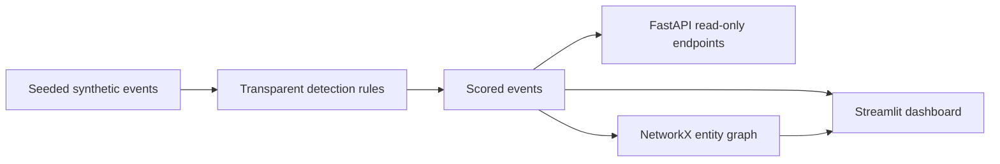

<div align="center">

# 🛡️ SentinelGraph AI

### Explainable security-event investigations, visualized.

**A hands-on cybersecurity analytics prototype with an interactive dashboard, transparent detection rules, an entity graph, and a read-only API.**

[](https://github.com/tasnem-tech/sentinelgraph-ai/actions/workflows/ci.yml)


*Design concept animation. The implemented Streamlit UI differs from these illustrative screens; AI chat and incident resolution shown above are not implemented.*

</div>

## Overview

SentinelGraph AI explores **synthetic authentication events** to make investigation workflows understandable. It scores events using four explicit rules, presents flagged activity in a Streamlit dashboard, and connects each event to a user, device, and IP address in an interactive Plotly/NetworkX graph.

> [!IMPORTANT]
> **Educational prototype, not a production SIEM.** No real customer telemetry, trained ML model, LLM assistant, live threat feed, or autonomous incident response is included. Risk scores are illustrative rule weights, **not probabilities** or validated predictions.

## Features available today

| Capability | Implementation |
| --- | --- |
| Synthetic event generation | Reproducible data via seeded Python RNG |
| Explainable risk scoring | Failed login, new device, unusual country, off-hours |
| Investigation dashboard | Streamlit metrics, severity chart, filterable event queue |
| Relationship graph | NetworkX + Plotly event-to-user/device/IP links |
| Evidence inspection | Selected alert and its triggered rule explanations |
| Export | Filtered alerts as CSV |
| Read-only REST API | FastAPI health, event list, and event detail endpoints |
| Engineering baseline | pytest, Ruff, Docker, GitHub Actions |

## Architecture



## Run locally

**Requirements:** Python 3.10+ and Git.

```bash
git clone https://github.com/tasnem-tech/sentinelgraph-ai.git
cd sentinelgraph-ai
python -m venv .venv
source .venv/bin/activate  # Windows: .venv\Scripts\activate
python -m pip install -e '.[dev]'
streamlit run app.py
```

Open **http://localhost:8501**. If you have not published the repository yet, unzip the project and run these commands from its folder, starting at `python -m venv .venv`.

### Run the API

In a second terminal, with the same environment activated:

```bash
uvicorn sentinelgraph.api:app --reload
```

Interactive API docs: **http://127.0.0.1:8000/docs**

```bash
curl http://127.0.0.1:8000/health
curl 'http://127.0.0.1:8000/events?count=20&min_score=50'
curl http://127.0.0.1:8000/events/evt-00001
```

### Run in Docker

```bash
docker build -t sentinelgraph-ai .
docker run --rm -p 8501:8501 sentinelgraph-ai
```

## Risk scoring methodology

| Trigger | Score contribution |
| --- | ---: |
| Failed authentication | +25 |
| Previously unseen device | +25 |
| Unusual country | +35 |
| Outside typical hours | +15 |

Severity thresholds: **low** below 25, **medium** 25–49, **high** 50–74, and **critical** 75–100. These are hand-selected demonstration weights, not empirically calibrated security risk estimates.

The event generator uses only synthetic identities and IPs from the documentation-only `192.0.2.0/24` TEST-NET-1 block.

## Quality checks

```bash
ruff check sentinelgraph tests
pytest -q
```

GitHub Actions runs linting and tests on pushes and pull requests. A passing badge will appear only after the workflow successfully runs in your GitHub repository.

## Repository structure

```text
sentinelgraph-ai/
├── .github/workflows/ci.yml    # Continuous integration
├── assets/sentinelgraph-demo.gif # Concept animation
├── sentinelgraph/
│   ├── api.py                  # FastAPI endpoints
│   └── core.py                 # Synthetic data, rules, graph
├── tests/                      # Unit and API tests
├── app.py                      # Streamlit dashboard
├── Dockerfile
├── pyproject.toml
├── LICENSE
└── README.md
```

## Roadmap

- [ ] Persist investigations and event history in a database
- [ ] Add authentication and access controls
- [ ] Add graph traversal across multiple related events
- [ ] Benchmark detection rules on appropriate labeled datasets
- [ ] Introduce optional ML anomaly detection with reproducible evaluation
- [ ] Add evidence-grounded AI explanations with clear source attribution
- [ ] Add operational telemetry and deployment documentation

## Responsible use and limitations

This project is designed for learning and demonstration. It does not ingest live security logs, guarantee threat detection, or justify automated enforcement. Synthetic patterns are not evidence of real-world accuracy. Do not use its scores as the sole basis for security decisions.

## Contributing

Issues and pull requests are welcome. Please include reproduction steps for bugs, tests for behavior changes, and avoid submitting sensitive or real security logs. Run `ruff check sentinelgraph tests` and `pytest -q` before opening a pull request.

## License

MIT. See [LICENSE](LICENSE).

---

<div align="center"><sub>Built as an educational security analytics and software engineering portfolio project.</sub></div>
