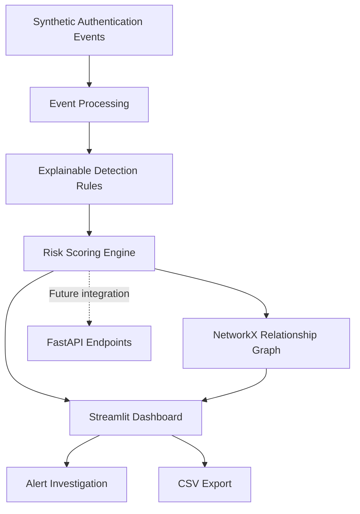

<div align="center">

# 🛡️ SentinelGraph AI

### Explainable Cybersecurity Intelligence & Threat Investigation

**Detect suspicious activity • Explore security relationships • Understand every alert**

An open-source cybersecurity analytics prototype combining transparent threat detection rules, interactive network visualization, and a security operations dashboard.

[](https://www.python.org/)
[](https://streamlit.io/)
[](https://fastapi.tiangolo.com/)
[](https://www.docker.com/)


### 🎬 Project Preview


*Visual design concept. This animation illustrates the intended interface, not the current working application. AI chat and incident resolution are not implemented.*

[**Overview**](#-overview) · [**Features**](#-features) · [**Architecture**](#-system-architecture) · [**Installation**](#-installation) · [**Roadmap**](#-development-roadmap)

</div>

---

## 📖 Overview

**SentinelGraph AI** is a cybersecurity investigation and security-event visualization project built with Python.

It is designed to help developers and security analysts explore synthetic authentication activity, understand explainable risk scores, and visualize relationships between security events.

The Streamlit dashboard code includes:

- Security event metrics and severity charts
- A filterable investigation queue
- Explainable, rule-based risk scoring
- Network visualization using NetworkX and Plotly
- Alert inspection and CSV export

> [!IMPORTANT]
> **Current status: Educational prototype with an incomplete GitHub upload.**
>
> The dashboard code is present, but the `sentinelgraph/` source package and automated tests are not currently uploaded. The application requires these files before it can run.
>
> This is not a production SIEM or validated AI threat detector. No trained ML model, LLM assistant, live threat intelligence, or autonomous incident response is included.

---

## ✨ Features

| Feature | Description | Status |
|:---|:---|:---|
| 🔍 Security Event Analysis | Explore synthetic authentication activity | Core package missing |
| 🛡️ Threat Detection | Four transparent security detection rules | Core package missing |
| 📊 Security Dashboard | Metrics, severity charts, and alert queues | Dashboard code present |
| 🕸️ Relationship Graph | Visualize users, devices, IP addresses, and events | Dashboard code present |
| 🧠 Explainable Alerts | Display reasons behind risk scores | Dashboard code present |
| 📁 CSV Export | Export filtered security events | Dashboard code present |
| ⚡ FastAPI | Read-only security-event endpoints | API file missing |
| 🐳 Docker | Container configuration | Dockerfile present |
| 🧪 Automated Testing | Unit and API tests | Not uploaded |
| 🔄 GitHub Actions | Continuous integration | Not uploaded |

**Note:** Dashboard features depend on the missing `sentinelgraph.core` module and cannot currently be executed from the public repository.

---

## 🏗️ System Architecture



### Technology Stack

| Category | Technology |
|:---|:---|
| Programming Language | Python 3.10+ |
| Dashboard | Streamlit |
| Visualization | Plotly |
| Graph Analysis | NetworkX |
| Data Processing | Pandas |
| Backend API | FastAPI (module pending) |
| Testing | pytest (tests pending) |
| Code Quality | Ruff |
| Containerization | Docker |
| CI/CD | GitHub Actions (planned) |

---

## 🔎 Detection Methodology

SentinelGraph AI is designed around four explainable detection rules.

| Detection Rule | Score Contribution |
|:---|---:|
| Failed authentication | +25 |
| Previously unseen device | +25 |
| Unusual country | +35 |
| Outside typical hours | +15 |

### Severity Classification

| Risk Score | Severity |
|:---|:---|
| 0–24 | 🟢 Low |
| 25–49 | 🟡 Medium |
| 50–74 | 🟠 High |
| 75–100 | 🔴 Critical |

These scores are illustrative rule weights. They are not probabilities of malicious activity and have not been calibrated against real-world security datasets.

---

## 🚀 Installation

### Prerequisites

- Python 3.10 or newer
- Git
- pip

> **Before running:** Restore the missing `sentinelgraph/` source package containing `core.py`, `api.py`, and `__init__.py`.

### Step 1: Clone the Repository

```bash
git clone https://github.com/tasnem-tech/sentinelgraph-ai.git
cd sentinelgraph-ai
```

### Step 2: Create a Virtual Environment

**macOS / Linux**

```bash
python3 -m venv .venv
source .venv/bin/activate
```

**Windows**

```powershell
python -m venv .venv
.venv\Scripts\activate
```

### Step 3: Install Dependencies

```bash
python -m pip install -e ".[dev]"
```

### Step 4: Start the Dashboard

After restoring the missing source package:

```bash
streamlit run app.py
```

Open your browser:

**http://localhost:8501**

---

## ⚡ REST API

The project configuration includes FastAPI and Uvicorn dependencies.

Once `sentinelgraph/api.py` has been uploaded, the intended API can be started using:

```bash
uvicorn sentinelgraph.api:app --reload
```

Interactive API documentation:

**http://127.0.0.1:8000/docs**

Planned endpoints include:

| Endpoint | Purpose |
|:---|:---|
| `GET /health` | API health status |
| `GET /events` | Retrieve security events |
| `GET /events/{event_id}` | Retrieve an individual event |

The API module is not currently present in the public repository.

---

## 🐳 Docker

A Dockerfile is included.

Once the missing source package has been restored, build and run the dashboard using:

```bash
docker build -t sentinelgraph-ai .
```

```bash
docker run --rm -p 8501:8501 sentinelgraph-ai
```

Then open:

**http://localhost:8501**

---

## 📂 Repository Structure

```text
sentinelgraph-ai/
│
├── app.py
├── README.md
├── LICENSE
├── Dockerfile
├── pyproject.toml
├── sentinelgraph-demo.gif
│
├── sentinelgraph/              # Not yet uploaded
│   ├── __init__.py
│   ├── core.py
│   └── api.py
│
├── tests/                      # Not yet uploaded
│
└── .github/
    └── workflows/
        └── ci.yml              # Not yet uploaded
```

---

## 🧪 Testing and Code Quality

Once the source package and test files have been restored, the intended commands are:

**Run tests**

```bash
pytest -q
```

**Check code quality**

```bash
ruff check sentinelgraph tests
```

A GitHub Actions workflow should run these checks automatically after the workflow file has been added.

No current passing CI status is claimed.

---

## 🗺️ Development Roadmap

### Phase 1: Complete the Prototype

- [x] Create the Streamlit dashboard interface
- [x] Add Plotly graph visualization code
- [x] Add CSV export interface
- [x] Add Dockerfile
- [x] Create a visual concept animation
- [ ] Upload the missing core Python package
- [ ] Upload the FastAPI module
- [ ] Restore automated tests
- [ ] Add GitHub Actions
- [ ] Verify the application runs successfully

### Phase 2: Advanced Security Analytics

- [ ] Persistent event storage
- [ ] Authentication and access control
- [ ] Multi-event graph investigations
- [ ] Detection performance benchmarks
- [ ] False-positive analysis
- [ ] Improved dashboard design

### Phase 3: AI-Powered Investigation

- [ ] Machine learning anomaly detection
- [ ] Reproducible model evaluation
- [ ] Evidence-grounded AI explanations
- [ ] Human-reviewed incident management
- [ ] Investigation history and audit trails

### Phase 4: Deployment and Reliability

- [ ] Live demonstration deployment
- [ ] Operational monitoring
- [ ] Security hardening
- [ ] Performance testing
- [ ] Deployment documentation
- [ ] Real dashboard demonstration GIF

---

## 🔐 Security and Responsible Use

SentinelGraph AI is intended for educational and research demonstrations.

- Uses synthetic security-event data.
- Does not require real customer logs.
- Does not provide validated threat-detection accuracy.
- Does not automatically block users or devices.
- Should not be used as the sole basis for security enforcement.

**Never upload real credentials, sensitive authentication logs, or private customer data to this repository.**

---

## 🤝 Contributing

Contributions, bug reports, and feature suggestions are welcome.

1. Fork the repository.
2. Create a new feature branch.
3. Implement and test your changes.
4. Submit a pull request.

Please include reproduction steps for bugs and tests for new functionality.

---

## 📜 License

This project is licensed under the **MIT License**.

See [LICENSE](LICENSE) for more information.

---

## 👩‍💻 Author

**Tasnem Islam Prome**

GitHub: [@tasnem-tech](https://github.com/tasnem-tech)

Project: [SentinelGraph AI](https://github.com/tasnem-tech/sentinelgraph-ai)

---

<div align="center">

### 🛡️ SentinelGraph AI

**Making security investigations more transparent, visual, and understandable.**

⭐ If you find this project useful, consider giving it a star!

[View Repository](https://github.com/tasnem-tech/sentinelgraph-ai) · [Report an Issue](https://github.com/tasnem-tech/sentinelgraph-ai/issues)

</div>


<div align="center">
🛡️ SentinelGraph AI
Explainable security-event investigations, visualized
An educational cybersecurity investigation prototype with a Streamlit dashboard, transparent detection rules, relationship graphs, and a planned read-only API.


License


Concept animation, not a screen recording of the current application. AI chat and incident resolution shown in the concept are not implemented.

Overview • Current status • Architecture • Getting started • Roadmap

</div>
Overview
SentinelGraph AI demonstrates how security analysts can explore synthetic authentication events, inspect explainable rule-based alerts, and visualize connections between events, users, devices, and IP addresses. The dashboard is written in Streamlit using Plotly and NetworkX.
[!IMPORTANT]
Educational prototype, not a production SIEM or validated AI threat detector. No live security telemetry, trained ML model, LLM assistant, live threat feeds, or autonomous incident response are included. Rule-based scores are illustrative weights, not probabilities.
Current repository status
The public GitHub repository currently contains app.py, pyproject.toml, Dockerfile, LICENSE, README.md, and sentinelgraph-demo.gif. The sentinelgraph/ source package, tests/, and GitHub Actions workflow have not been uploaded yet, so the app cannot run from the current repository as-is.
Capability	Status
Streamlit metrics, alert queue, filtering and charts	UI code present in app.py; requires missing core module
Selected event explanations	UI code present; requires missing core module
NetworkX/Plotly entity graph	UI code present; requires missing core module
CSV export	UI code present; requires missing core module
Synthetic event generator and scoring	Imported by dashboard; sentinelgraph/core.py missing
FastAPI read-only API	Dependency installed; sentinelgraph/api.py missing
Automated tests and GitHub Actions	Not yet uploaded
Dockerfile	Present; requires restored source package
Animated preview	Concept GIF at repository root
Architecture
Risk-scoring methodology
Detection trigger	Illustrative points
Failed authentication	+25
Previously unseen device	+25
Unusual country	+35
Outside typical hours	+15
Severity thresholds are low 0–24, medium 25–49, high 50–74, and critical 75–100. These are hand-selected demo values, not validated risk estimates.
Getting started
Requirements: Python 3.10+ and Git. First restore the missing sentinelgraph/ Python package.
git clone https://github.com/tasnem-tech/sentinelgraph-ai.git
cd sentinelgraph-ai
python3 -m venv .venv
source .venv/bin/activate
python -m pip install -e '.[dev]'
streamlit run app.py
On Windows, activate with .venv\Scripts\activate instead. When the missing core module is present, open http://localhost:8501.
API (after uploading its module)
uvicorn sentinelgraph.api:app --reload
Interactive documentation will then be available at http://127.0.0.1:8000/docs.
Docker (after restoring source files)
docker build -t sentinelgraph-ai .
docker run --rm -p 8501:8501 sentinelgraph-ai
Testing and quality
Once the test files and Python package are uploaded:
ruff check sentinelgraph tests
pytest -q
No GitHub Actions success or passing test badge is claimed until a workflow is uploaded and run.
Repository structure
sentinelgraph-ai/
├── README.md
├── LICENSE
├── app.py
├── pyproject.toml
├── Dockerfile
├── sentinelgraph-demo.gif
├── sentinelgraph/             # Missing from public repository
│   ├── __init__.py
│   ├── core.py
│   └── api.py
├── tests/                     # Missing from public repository
└── .github/workflows/ci.yml   # Missing from public repository
Roadmap
Upload missing source package and tests
Add and verify GitHub Actions workflow
Replace concept GIF with real dashboard recording
Persist event history and investigations
Add authentication and authorization
Expand cross-event relationship analysis
Benchmark detection rules on labelled datasets
Experiment with reproducible ML anomaly detection
Add evidence-grounded AI explanations with human oversight
Add monitoring and deployment documentation
Responsible use
This project is for learning and demonstration. Never submit real customer logs, credentials, or personal data to this prototype. Synthetic data cannot establish real-world detection accuracy, and the scores should not be used alone for enforcement decisions.
Contributing
Contributions and bug reports are welcome. Include reproducible steps for defects, tests for behavior changes, and no sensitive logs or credentials.
License
MIT. See LICENSE.
<div align="center">
Built as an educational security analytics and software engineering portfolio project.
View repository · Report an issue
</div>


