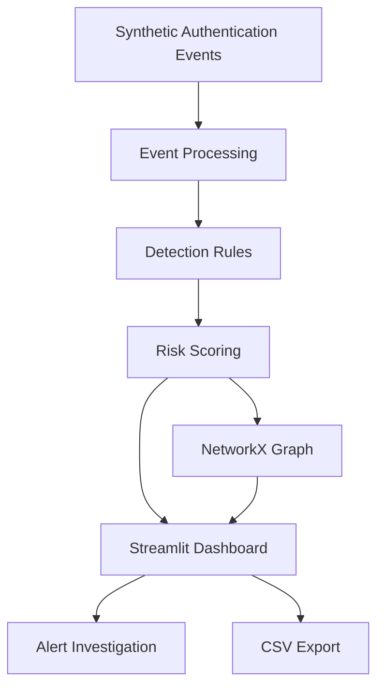

<div align="center">

# 🛡️ SentinelGraph AI

### Explainable Cybersecurity Intelligence & Security Investigations

**Detect suspicious activity · Explore relationships · Understand security alerts**

An open-source cybersecurity analytics prototype featuring a visual investigation dashboard, explainable detection rules, and entity relationship graphs.


### 🎬 Project Preview


*Concept animation illustrating the intended interface. Not a recording of the working application.*

[Overview](#-overview) · [Features](#-features) · [Architecture](#-architecture) · [Installation](#-installation) · [Roadmap](#-roadmap)

</div>

---

## 📖 Overview

**SentinelGraph AI** is a Python-based cybersecurity investigation prototype designed to help developers explore synthetic authentication events and understand security alerts.

The project combines:

- Explainable, rule-based threat detection
- Security-event visualization
- Interactive investigation dashboards
- User, device, and IP relationship graphs
- Synthetic security data
- CSV export capabilities

> [!IMPORTANT]
> **Project status:** The Streamlit dashboard code is available, but the `sentinelgraph/` source package and automated tests still need to be uploaded to GitHub.
>
> This is an educational prototype, not a production SIEM or validated AI threat detector.

---

## ✨ Features

| Feature | Description |
|---|---|
| 🔍 Security Analytics | Explore synthetic authentication activity |
| 🛡️ Threat Detection | Four transparent detection rules |
| 📊 Dashboard | Metrics, severity charts, and event queue |
| 🕸️ Graph Visualization | Explore users, devices, IP addresses, and events |
| 🧠 Explainable Alerts | Understand triggered detection rules |
| 📁 CSV Export | Download filtered security events |
| 🐳 Docker | Container configuration included |
| ⚡ FastAPI | Planned read-only event API |
| 🧪 Testing | Automated tests pending upload |

The dashboard features require the missing core Python package before they can run.

---

## 🏗️ Architecture



### Technology Stack

| Component | Technology |
|---|---|
| Programming | Python |
| Dashboard | Streamlit |
| Visualization | Plotly |
| Graph Analysis | NetworkX |
| Data Processing | Pandas |
| API | FastAPI, pending upload |
| Testing | pytest, pending upload |
| Code Quality | Ruff |
| Containers | Docker |

---

## 🔎 Risk Scoring

SentinelGraph AI uses illustrative detection-rule weights.

| Detection Rule | Score |
|---|---:|
| Failed authentication | +25 |
| New device | +25 |
| Unusual country | +35 |
| Outside typical hours | +15 |

### Severity Levels

| Score | Severity |
|---|---|
| 0–24 | Low |
| 25–49 | Medium |
| 50–74 | High |
| 75–100 | Critical |

**Note:** These values are demonstration weights, not validated probabilities of malicious activity.

---

## 🚀 Installation

### Requirements

- Python 3.10+
- Git
- pip

**The missing `sentinelgraph/` package must be restored before the application can run.**

### 1. Clone the repository

```bash
git clone https://github.com/tasnem-tech/sentinelgraph-ai.git
cd sentinelgraph-ai
```

### 2. Create a virtual environment

```bash
python3 -m venv .venv
source .venv/bin/activate
```

For Windows, activate with:

```powershell
.venv\Scripts\activate
```

### 3. Install dependencies

```bash
python -m pip install -e ".[dev]"
```

### 4. Run the dashboard

```bash
streamlit run app.py
```

Open:

http://localhost:8501

---

## 🐳 Docker

Once the missing source files are restored:

```bash
docker build -t sentinelgraph-ai .
docker run --rm -p 8501:8501 sentinelgraph-ai
```

---

## 📂 Repository Structure

```text
sentinelgraph-ai/
├── README.md
├── LICENSE
├── app.py
├── Dockerfile
├── pyproject.toml
├── sentinelgraph-demo.gif
├── sentinelgraph/              # Pending upload
│   ├── __init__.py
│   ├── core.py
│   └── api.py
├── tests/                      # Pending upload
└── .github/
    └── workflows/
        └── ci.yml              # Pending upload
```

---

## 🗺️ Roadmap

### Phase 1: Complete the Prototype

- [x] Create dashboard interface
- [x] Add visualization code
- [x] Add CSV export interface
- [x] Configure Docker
- [ ] Upload missing Python source package
- [ ] Upload automated tests
- [ ] Add GitHub Actions
- [ ] Verify the complete application

### Phase 2: Advanced Security Analytics

- [ ] Persistent event storage
- [ ] Authentication and authorization
- [ ] Multi-event graph investigations
- [ ] Detection performance evaluation
- [ ] Improved dashboard design

### Phase 3: AI Integration

- [ ] Machine learning anomaly detection
- [ ] Evidence-grounded AI explanations
- [ ] Investigation assistant
- [ ] Human-reviewed incident workflows

### Phase 4: Production Engineering

- [ ] Cloud deployment
- [ ] Monitoring
- [ ] Security hardening
- [ ] Performance testing
- [ ] Real dashboard demonstration GIF

---

## 🔐 Responsible Use

SentinelGraph AI is intended for education and software engineering demonstrations.

It does not process live security logs, provide validated detection accuracy, or automatically respond to security incidents.

Never upload sensitive logs, personal information, or credentials.

---

## 🤝 Contributing

Contributions, bug reports, and feature suggestions are welcome.

1. Fork the repository.
2. Create a feature branch.
3. Implement and test changes.
4. Submit a pull request.

---

## 📜 License

Licensed under the MIT License.

See [LICENSE](LICENSE).

---

## 👩‍💻 Author

**Tasnem Islam Prome**

GitHub: [@tasnem-tech](https://github.com/tasnem-tech)

Repository: [SentinelGraph AI](https://github.com/tasnem-tech/sentinelgraph-ai)

---

<div align="center">

### 🛡️ SentinelGraph AI

**Making cybersecurity investigations more transparent, visual, and understandable.**

⭐ If you find this project useful, consider starring the repository.

</div>
