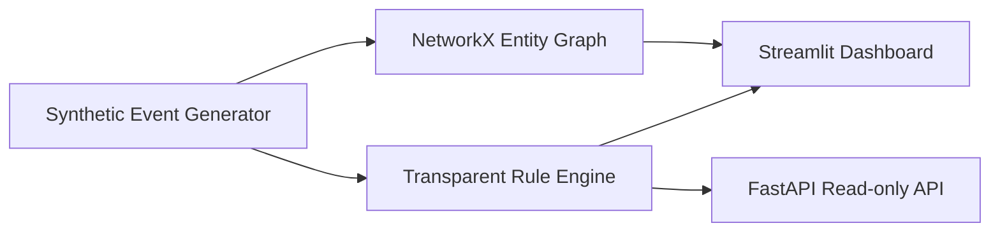

# 🛡️ SentinelGraph AI

**Visual, explainable security-event investigation with synthetic telemetry.**

> **Status: educational prototype.** This release implements deterministic synthetic data generation, transparent rules, an interactive dashboard, an entity graph, a read-only API, and tests. It is **not** a production security monitoring solution. There is no trained AI model or LLM assistant in this release; the name reflects the intended roadmap.

## Features

- Interactive dark-themed Streamlit dashboard with event counts, alerts, and CSV export
- Event-to-user/device/IP relationship visualization using NetworkX and Plotly
- Explainable rule scoring: failed authentication, new device, unusual country, and off-hours
- FastAPI endpoints with interactive OpenAPI documentation
- Deterministic synthetic data only, using reserved TEST-NET-1 IP addresses
- Automated tests and CI workflow

## Quick start

Requires Python 3.10+.

```bash
python -m venv .venv
source .venv/bin/activate  # Windows: .venv\\Scripts\\activate
pip install -e '.[dev]'
streamlit run app.py
```

Visit http://localhost:8501.

To run the API separately:

```bash
uvicorn sentinelgraph.api:app --reload
```

API documentation: http://127.0.0.1:8000/docs

```bash
curl http://127.0.0.1:8000/health
curl 'http://127.0.0.1:8000/events?count=20&min_score=50'
```

## Docker

```bash
docker build -t sentinelgraph-ai .
docker run --rm -p 8501:8501 sentinelgraph-ai
```

## Testing

```bash
ruff check sentinelgraph tests
pytest -q
```

## Architecture



## Limitations and safety

- All data is synthetic and generated locally. No actual security logs are collected.
- Scores are hand-set **illustrative risk scores**, not threat probabilities or measured detection performance.
- "Unusual country" is a synthetic flag, not a real geolocation or identity determination.
- No authentication, persistent storage, real-time streaming, ML training, or production monitoring is included.
- Do not use this system to make security decisions without proper validation and controls.

## Roadmap

- [ ] Authenticated event ingestion and audit logs
- [ ] Persistent PostgreSQL storage and migrations
- [ ] Time-window aggregation and correlation rules
- [ ] Benchmarked anomaly detection with false-positive evaluation
- [ ] Evidence-grounded AI investigation summaries
- [ ] Observability, threat-model review, and deployment guide

## Contributing

Issues and pull requests are welcome. Please use synthetic or appropriately sanitized examples and never commit secrets, personal data, or live credentials.

## License

MIT. See [LICENSE](LICENSE).
